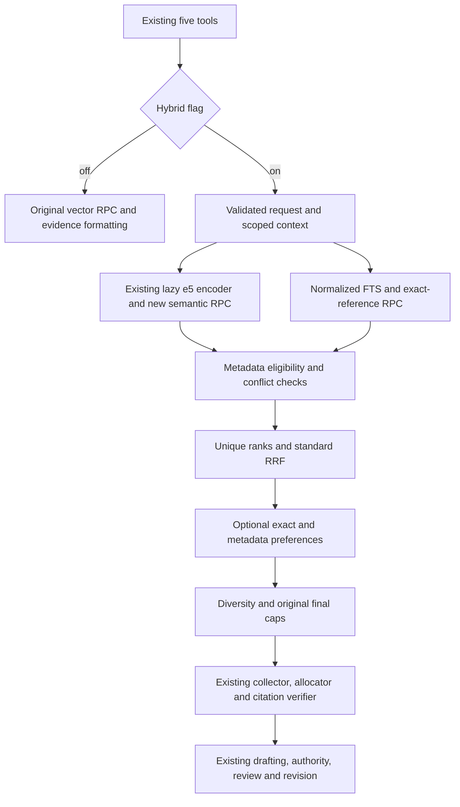

# Phase 2A hybrid legal retrieval

The independent `ENABLE_HYBRID_LEGAL_RETRIEVAL=false` flag preserves the Phase 1.5
retrieval path by default. Five existing tool names, family meanings, legacy RPC
names/arguments, thresholds, final counts, formatting and graph routing remain
unchanged while disabled. No new agent, database service or production dependency
is introduced. `schema.sql` and the five legacy vector RPCs are not modified.



## Components and contracts

`retrieval/schemas.py` defines typed requests, candidates, source classifications,
provenance, eligibility and branch/result states. `normalization.py` implements
search-only NFKC/lowercase, selected Alef folding, diacritic/tatweel removal, and
Arabic/Persian digit normalization. It preserves ta marbuta/ha and ya/alef maqsura
distinctions and keeps `7.3` different from `7/3`. Original records are never edited.

`query_analysis.py` extracts numeric article/clause and law/decree-law/regulation
references conservatively. A year in `Law No. 12 of 2020` / `القانون رقم 12 لسنة
2020` is retained in the identifier (`law:12:2020`). No partial number match proves
an instrument identity. More than 16 explicit references is an invalid query,
not a silently truncated exact-match condition. Named titles use lexical matching;
this is not a full legal-entity resolution system.

`semantic.py` calls `hybrid_semantic_v1` through the existing Supabase client and
`encode_query`. The original `intfloat/multilingual-e5-large`, `query: ` prefix,
1024 dimensions, lazy initialization and model-load lock are retained. One scoped
embedding cache serves repeated identical queries across tools (at most 32 entries),
with a lock for parallel calls. No document embeddings are regenerated.

`lexical.py` calls `hybrid_lexical_v1` with bound values. PostgreSQL uses `simple`
configuration, normalized title/passage expression indexes, up to 32 normalized
word/number terms joined as a websearch OR query, and `ts_rank_cd`. Structured
article/clause/instrument index predicates supplement text matching. This is **not
BM25**, stemming, Arabic morphology, translation or trigram fuzzy search.

An exact signal requires all extracted references in the same row: matching
independently reviewed structured identifiers or labeled source-text identifiers.
Raw numbers alone do not qualify. Structured fields require `identity_verified`
and a valid `verified_at`. The signal describes reference matching, not legal
validity. Year-specific and decree-law/generic-law identities remain distinct.

`provenance.py` validates optional `metadata.retrieval_v1` without promoting legacy
records. `eligibility.py` checks family/source purpose, six independent jurisdiction
dimensions and dates. SQL applies the same preliminary constraints **before** its
candidate limit, then Python validates returned rows again. SQL/Python parity is
executed against synthetic cases in the disposable database suite.

`fusion.py` deduplicates by `(family, chunk_id)` and assigns unique ranks before
standard RRF: `score(d) = sum(1 / (k + rank_i(d)))`, default `k=60`. Cosine and
lexical raw scores are never added. Per-branch rank contributions remain on the
internal candidate. Exact priority and compatible-metadata preference are separate,
configurable ordering stages; they do not modify the RRF score. Sort order is:
exact-match priority, metadata compatibility preference, descending RRF, family,
numeric chunk ID. Both optional preferences can be disabled.

`engine.py` orchestrates the two branches sequentially with bounded pools. A source
rejected by one branch cannot be restored by the other under the same identity.
Conflicting title/text/provenance versions are excluded and reported as invalid
metadata. Missing stable IDs are rejected; titles alone never identify documents.
Diversity uses a supplied `source_document_id`, never a guessed title identity.
Distinct articles remain distinct; a configurable cap can exclude additional
passages and records the exclusion count.

`context.py` owns request-local context, embedding reuse and bounded diagnostics.
`evidence.py` allocates only final references, reuses repeated references within
the same collector, and keeps passage verification aligned to the exact displayed
body. `diagnostics.py` exposes only operational categories/counts/timings internally.
There is no search-debug endpoint and no raw query/document/provider-error logging.

## Configuration and integration

| Setting | Default | Bound / meaning |
| --- | --- | --- |
| `ENABLE_HYBRID_LEGAL_RETRIEVAL` | `false` | Independent of legal skills |
| `HYBRID_CANDIDATE_POOL` | `30` | 1..100 per branch |
| `HYBRID_RRF_K` | `60` | 1..200 |
| `HYBRID_MAX_PER_DOCUMENT` | `2` | 1..20; known document IDs only |
| `HYBRID_UNKNOWN_POLICY` | `research_lead` | Or `exclude` for strict metadata filtering |
| `HYBRID_EXACT_PRIORITY` | `true` | Optional exact-reference ordering |
| `HYBRID_PREFER_COMPATIBLE` | `true` | Optional compatible-metadata-before-unknown ordering within the exact tier |

Final caps remain legislation=3, drafts=2, contracts=4, notices=3, POA=3. Legacy
thresholds remain .75 for legislation and .70 otherwise. Parity tests guard these
values. Internal pools and final LLM evidence counts are different quantities.

`POST /generate` accepts an optional `retrieval_context` when hybrid is enabled:

```json
{
  "prompt": "Review the supplied fictional agreement",
  "retrieval_context": {
    "jurisdiction": {"governing_law":"difc", "court_jurisdiction":"difc"},
    "as_of": "2026-01-15"
  }
}
```

Other jurisdiction dimensions are `regulatory_jurisdiction`,
`contractual_choice_of_law`, `subject_matter_jurisdiction`, `procedural_rules`.
Use the existing seven UAE values or `unknown`. If no retrieval jurisdiction is
supplied, an explicit `skill_jurisdiction` can provide the search scope independently
of the skills flag. The existing CaseFile forum normalizer preserves ADGM/DIFC
court context without inferring governing law. Conflicting court inputs return
400 before streaming; a known non-UAE case stops retrieval. Dates require YYYY-MM-DD.

Search filters are not confirmed case facts: the skills intake remains separate.
The field is ignored with hybrid off, including for legacy clients that never
send it. Chat retains its existing transport and gets an unknown scoped context
through its existing evidence-collection round. Direct tools also get isolated
scopes. All four combinations of the two feature flags are tested.

The SSE worker explicitly opens/closes retrieval scope inside its thread. Existing
`EvidenceCollector`/ContextVar lifecycle is retained. The Next.js proxy forwards
the optional JSON field without frontend changes; an actual production-proxy test
confirmed differing DIFC/federal scopes select/exclude evidence as expected.
Existing authentication, citation/authority checks and post-revision verification
remain active. No new SSE frame type or response-contract change is introduced.

## Failures, costs and limits

Empty/invalid query, unsupported context, migration absence, embedding failure,
RPC absence/permissions/timeout, malformed metadata and legal exclusions are
separate statuses/counters. A surviving branch is explicitly degraded. Missing
migration never triggers DDL or a fallback to unfiltered legacy results. Known
ineligible sources are never restored to fill a cap. Operational errors are not
represented as successful full-hybrid search.

Safe diagnostics include branch/total/fusion latency, candidate observations,
selected/filtered/unknown/invalid counts, diversity exclusions and displayed/context
character counts. Counts across branches are observations, not a claim about the
entire database. Database-prefilter rejection totals are not measured by fetching
all rejected rows. Model data and provisional IDs are not placed in diagnostics.

No extra LLM/reranking service call is introduced; the two database branches add a
second RPC. Provenance/fencing adds bounded prompt overhead, not zero cost. Final
passages retain the existing 1800-character budget. Long-chunk relevant suffixes
may remain undisplayed; unseen text cannot support a verified quotation.

Indexes and limits prevent unbounded application-side corpus downloads. Broad FTS
terms can still require substantial database ranking work, and ANN filtering can
underfill pools on large corpora. Configure caller/server query timeouts and test
production-sized plans before enabling. The tiny synthetic benchmark does not
establish production latency, Arabic semantic accuracy or legal applicability.
