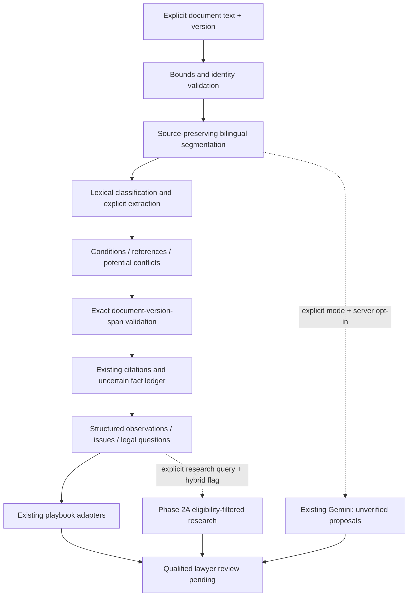

# Phase 2B architecture

Phase 2B adds a request-local deterministic contractual analysis subsystem. It
analyzes explicitly supplied, already-extracted text. No OCR, ingestion rebuild,
database migration, paid provider or production dependency was added. Python's
standard library and existing host modules implement the core.



## Contracts and responsibilities

`schemas.py` defines frozen document, clause, entity, defined-term, obligation,
condition, financial-term, date-term, cross-reference and finding dataclasses.
`AnalysisRequest.from_payload` validates bounded input with fixed safe exceptions.
The report uses schema version `phase2b.v1` and JSON primitives.

`Document` binds an identifier and version to a SHA-256 hash of the exact UTF-8
source. Every `EvidenceSpan` contains that identity/hash, clause ID, quote and
start/end offsets. Offsets are **Python Unicode code points, zero-based,
end-exclusive**, not UTF-8 bytes or JavaScript UTF-16 positions. Combining marks,
CRLF and emoji are retained. Consumers must convert indexes if using UTF-16 APIs.

`parser.py`/`segmentation.py` recognize line-anchored English/Arabic articles,
clauses, numeric dot/slash nesting, parenthetical letters, common Arabic ordinal
labels, recitals, definitions, schedules/annexes, signatures and amendments.
Paragraph boundaries without numbering remain candidates. A four-digit standalone
number remains structurally ambiguous. Internal `C-0001` IDs identify segments;
they are not invented contractual clause numbers. `label` can be null. Duplicate
labels are preserved, not renumbered. Whitespace between spans is not presented
as an extracted provision; every reported quote is an exact source slice.

`classification.py` applies an auditable bilingual cue taxonomy. It supports
multiple categories and an explicit `other` category. Labels are candidates,
not legal effect or calibrated probabilities. Search-only normalization never
changes evidence. No training or proven NLI is claimed.

`entities.py` extracts explicit role/name and parenthesized party definitions,
tracks role aliases and identifies collisions. It also recognizes quoted terms
with explicit “means”/Arabic definition language. Person type is an indicator or
unknown. A signatory is not treated as legally authorized. Arbitrary aliases,
elliptical references and complex bilingual equivalence require review.

`obligations.py`, `conditions.py` and `terms.py` produce modal/action candidates,
parties where recoverable, beneficiary where explicit, financial contexts,
conditions, triggers, exceptions and relative/absolute dates. Condition fulfilment,
debt due status and performance remain unknown. They are not inferred from wording.
Day counting delegates to `deadlines.add_period` only through an explicit caller
adapter with confirmed anchor, convention and necessary holiday inputs. The HTTP
analysis does not assume these inputs or calculate overdue status. No financial
total, liability exposure or risk probability is invented.

`references.py` resolves internal clause/schedule labels and detects missing,
ambiguous, duplicate and circular references without recursive graph traversal.
Conditions link resolved target clause IDs. `consistency.py` compares tightly
matched actor/action/trigger deadline candidates, matching liability-cap contexts,
governing-law wording, defined-term wording and notice addresses. Findings always
say `potential_conflict`; scopes, versions, exceptions and amendment precedence
may explain differences. It is not an exhaustive contradiction solver.

`reasoning.py` separates six support states. `evidence.py` checks exact source
identity/version/hash/offset/clause membership, then reuses `citations.Evidence`,
`RefAllocator` and `verify_citations`. Its local quote-presence check permits short
source spans only after exact structural validation; established generation quote
thresholds are unchanged. It creates an existing `FactLedger` with `UNCERTAIN`
standing and calls `assert_system_does_not_agree`; no agreed facts are created.
`authority.asserted_without_source` remains a legal-assertion guard. Attribution,
claims, authority, review, revision and generation verification remain untouched.

## Flags and integration

| Setting | Default | Effect |
| --- | --- | --- |
| `ENABLE_CLAUSE_INTELLIGENCE` | `false` | Enables the new authenticated endpoint |
| `ENABLE_CLAUSE_MODEL_ASSISTANCE` | `false` | Permits explicitly requested Gemini proposals |
| `ENABLE_LEGAL_SKILLS` | existing default `false` | Independently permits playbook activation |
| `ENABLE_HYBRID_LEGAL_RETRIEVAL` | existing default `false` | Independently permits explicit external research |

The standalone Python core is callable offline for tests/tools irrespective of
the HTTP activation flag. The endpoint gates activation. Ordinary `/generate`,
chat/archive requests, five retrieval tools, SSE frames and existing flags are
unchanged. Analysis is a separate explicit workflow, not silently injected into
drafting prompts or session history.

Playbook adapters reuse registry validation, routing/activation, versions, required
inputs and output sections. Contract review uses all clauses; NDA and corporate
due diligence focus relevant categories. Risk uses the existing unknown-score
result without supplied ratings. Negotiation supplies separate illustrative
preferred/fallback draft proposals for evidence gaps/conflicts, never agreed edits.

External research uses only an explicit `research_query`, never automatically the
document body, through `HybridRetrievalEngine` with the existing six jurisdiction
dimensions, as-of date and authority source classes. Contractual text, precedents,
policy and external authority stay separate. Retrieval never satisfies legal
applicability by itself. Missing migration/network/model access reports a gap and
does not stop offline analysis. No new database objects are required.

## API

`POST /analyze/clauses` uses existing `require_token` and **also requires a configured
service token in development**. Disabled: 404. Missing/wrong token: 401 when
configured. Unconfigured token while enabled: 503. Invalid input: safe 400 without
echoing document contents. Streamed body >650,000 bytes: 413.

Browser/application clients use **`POST /api/analyze/clauses`** through the existing
Next.js catch-all server proxy. API_TOKEN/BACKEND_URL stay server-side. Do not put
the token in browser code or a `NEXT_PUBLIC_` variable.

```json
{
  "document_id": "fictional-agreement",
  "document_version": "v1",
  "document_text": "1 يلتزم المورد بالسداد خلال خمسة عشر يوم عمل بعد استلام الفاتورة.",
  "document_type": "agreement",
  "language": "ar",
  "client_role": "supplier",
  "jurisdiction": {"governing_law": "uae_federal"},
  "analysis_mode": "deterministic",
  "playbook": "uae-contract-review"
}
```

This yields a conditional obligation candidate, a 15-working-day relative period,
an exact source span, unresolved date and `human_review_status: "pending"`.
The complete response contains `document`, `clauses`, `parties`, `defined_terms`,
`obligations`, `financial_terms`, `dates`, `conditions`, `cross_references`,
`findings`, citation references, playbook/model/research status, gaps and diagnostics.
The supplied jurisdiction is context, not a verified legal conclusion. English,
Arabic and bilingual modes preserve quotations; Arabic issue explanations and
negotiation drafts are localized. Machine field/category keys remain stable English.

Optional `claims` accepts at most 30 propositions with `claim_text`, `claim_type`,
`evidence` and optional `contradictory_evidence`. Evidence fields are exactly:
`document_id`, `version`, `content_sha256`, `clause_id`, `start`, `end`, `quote`.
Optional `research_query` (500 characters) and ISO `as_of` explicitly request
external research. `analysis_mode: "model_assisted"` additionally requires the
model server flag. Without that flag the report says disabled, not model success.

## Resource and confidentiality boundaries

Documents are limited to 100,000 code points, 4,000 newline characters, 600 segments
and 20,000 characters per segment. Each extracted record family is limited to
2,000 entries. Excess input is rejected, not silently truncated. Model source
text is limited to 24,000 characters, proposals to 20 and raw output to 12,000
characters; the existing Gemini call additionally caps output at 2,048 tokens.
Core work runs in a worker thread; no shared document state or persistent store
is introduced. Diagnostics contain counts/timing only. Documents are not logged.

Model input is fenced with existing `untrusted.fence`; document instructions are
never executed. Prompt tracing opt-ins are rejected in the endpoint's model
adapter. No filesystem path, URL loading, remote script or archive write is accepted.
The existing shared token is service authentication, **not user authentication or
tenant authorization**. Production rate/concurrency limits, storage policy, proxy
access controls and independent privacy review still require operator attention.
