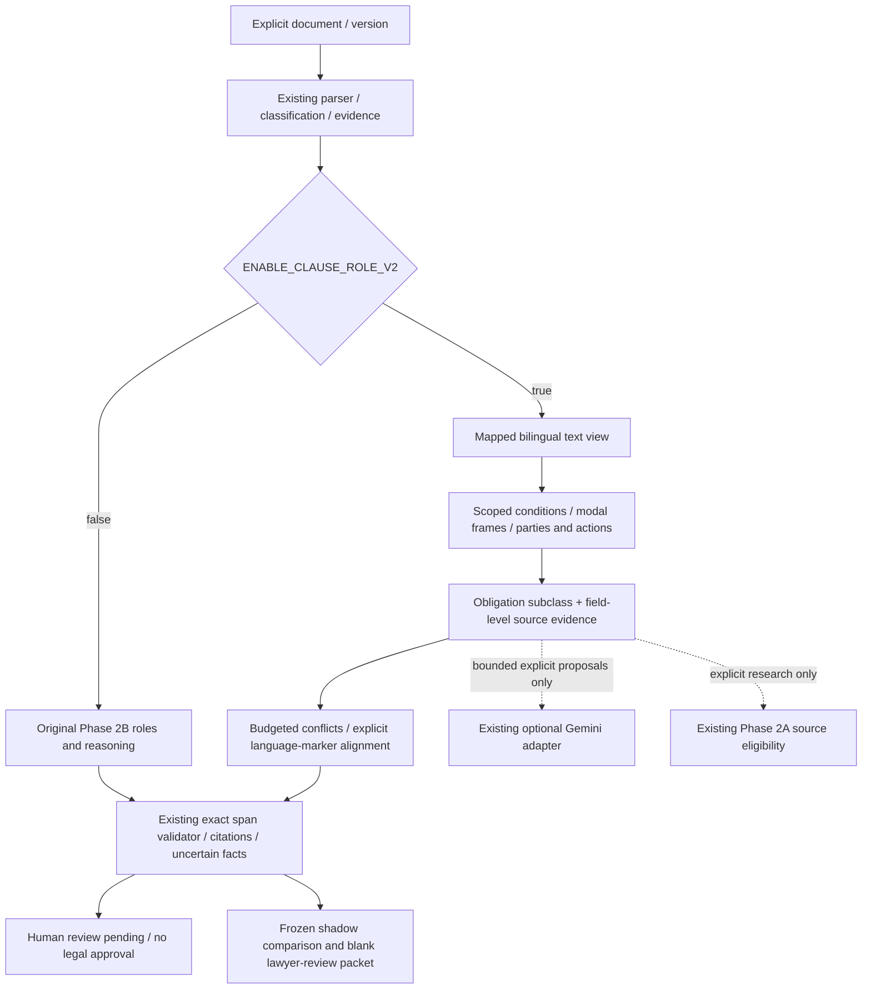

# Phase 2C architecture

Phase 2C adds an optional deterministic role adapter to the existing clause
pipeline, not a new orchestration system. Default `ENABLE_CLAUSE_ROLE_V2=false`
retains Phase 2B extraction and the `phase2b.v1` response. No existing flag default,
enum, generation/SSE contract, retrieval tool, model or database schema changed.
No production dependency was added.



## Audited Phase 2B defects

Executed examples reproduced: “Neither party may disclose” became permission;
“No commission shall be payable unless…” assigned an actor named “No commission”;
Arabic negative entitlement/right forms lost negation or actor identity; direct
payment beneficiaries were absent; and a second actor/modal in one sentence was
discarded. Generic prefixes could be presented as actors. Objects were duplicated
action phrases, preventing meaningful full-role evaluation. Existing exact quote,
version, citation, fact and authority safeguards were preserved, not replaced.

## Additive contracts

`RoleObligation` subclasses the existing `Obligation`; `semantic_role` contains
actor/action/object/beneficiary `RoleValue`s, modality, polarity, obligation type,
modal evidence, condition/trigger/exception IDs, deadline/financial IDs,
consequence, uncertainty and unknown fulfilment/liability status. Actor status
distinguishes `explicit`, `from_definition`, `ambiguous` and `unknown`. Definitions
remain evidence, not proof of legal personality or signatory authority.

Values have exact source evidence or remain unknown. Canonical action names are
controlled lexical candidates, with the original surface span retained. They
are not verified translations or proven semantic predicates. The existing
obligation fields remain available; new interpretation distinctions such as
`negative_entitlement` and `conditional_right` live in the additive role contract.

`role_text.TextView` maps a matching-only normalization back to original Unicode
positions, including Arabic diacritics, Alef forms, combining marks and non-BMP
characters. Source text and Python code-point/end-exclusive offsets are unchanged.
The existing `EvidenceSpan` identity/version/hash/clause/quote contract remains
authoritative. Every nested v2 span is checked by the existing span validator.

## Extraction and reasoning

`roles_v2.py` resolves controlled role expressions and explicit defined names,
including attached Arabic prepositions. It segments modal scopes, separates
actors and coordinated actions, and binds local financial/deadline modifiers.
It does not confirm an actor from an arbitrary sentence prefix. Unknown actions
and ambiguous aliases remain explicit. Complex negation such as “not only” or
“shall not fail to” causes abstention rather than a confident polarity reversal.

`conditions_v2.py` distinguishes condition precedent/subsequent, trigger,
exception, carve-out, reservation and dependency. Nested qualifications retain
their parent relationship, preventing an event inside an exception from becoming
an unconditional trigger. Negative payment “unless” constructions are conditions
precedent. Fulfilment always stays unknown. `terms_v2.py` reuses date contracts
and adds limited word-number coverage; it never invents an anchor/counting rule.
Existing `deadlines.py` remains the counting authority.

`consistency_v2.py` uses actor/action/object/trigger/scope keys, currency/context
boundaries, exception abstention and amendment/precedence review flags. It caps
comparisons at 5,000 and issues at 100, with explicit diagnostics. It reports
potential conflicts, never confirmed contradictions or legal precedence.
`alignment.py` requires explicit same-number `AR version Clause N` and
`EN version Clause N` markers. Amount, period, polarity/modality or notice-form
differences are candidates. Missing/repeated markers remain uncertain. Absence
of a detected divergence is not equivalence. No language is selected to prevail.

Existing six support states are retained. `reasoning_v2.py` adds support levels:
exact text, structural expression presence, interpretive inference and legal
applicability. Arbitrary interpretations and all model proposals remain unverified.
Existing citation allocation/checking, uncertain FactLedger, authority assertion
guard, playbooks, retrieval eligibility and review/revision safeguards remain active.

## API and activation

The existing `POST /analyze/clauses` / Next.js `/api/analyze/clauses` path remains.
With the v2 flag off, neither `semantic_role` nor `role_analysis` is added. With
it on, top-level `schema_version` stays `phase2b.v1`; additive `role_analysis` has
`schema_version: phase2c.roles.v1`, alignment candidates and comparison diagnostics.
Activation is server controlled, not a client-side bypass of a disabled flag.

Existing `ENABLE_LEGAL_SKILLS`, `ENABLE_HYBRID_LEGAL_RETRIEVAL`,
`ENABLE_CLAUSE_INTELLIGENCE` and `ENABLE_CLAUSE_MODEL_ASSISTANCE` remain independent.
All eight subsystem flag combinations are tested in both role modes (16 cases).
Enabling roles never enables model assistance, skills or external retrieval.

Example explicitly supplied fictional source:

```json
{"document_id":"fictional-review","document_version":"v1","language":"bilingual",
 "document_text":"1 Neither party may disclose records.\n2 لا يستحق الوسيط العمولة إلا بعد إتمام الصفقة."}
```

The role output distinguishes prohibition from negative conditional entitlement;
it does not establish completion or currently payable commission. Original quotes
are preserved. No source instructions are executed, no new storage is introduced,
and no report grants signature approval. Generation, chat/archive, UI/RTL/fonts
and production migration state are unaffected.

Endpoint security now bounds two admitted requests per process, body reads to
10 seconds and bodies to the existing 650,000 bytes. Capacity returns 429 with
Retry-After. Cancellation retains admission until the protected worker finishes.
These are operational hardening changes in both modes; they do not change normal
analysis output. See the security report for limits and ingress requirements.
