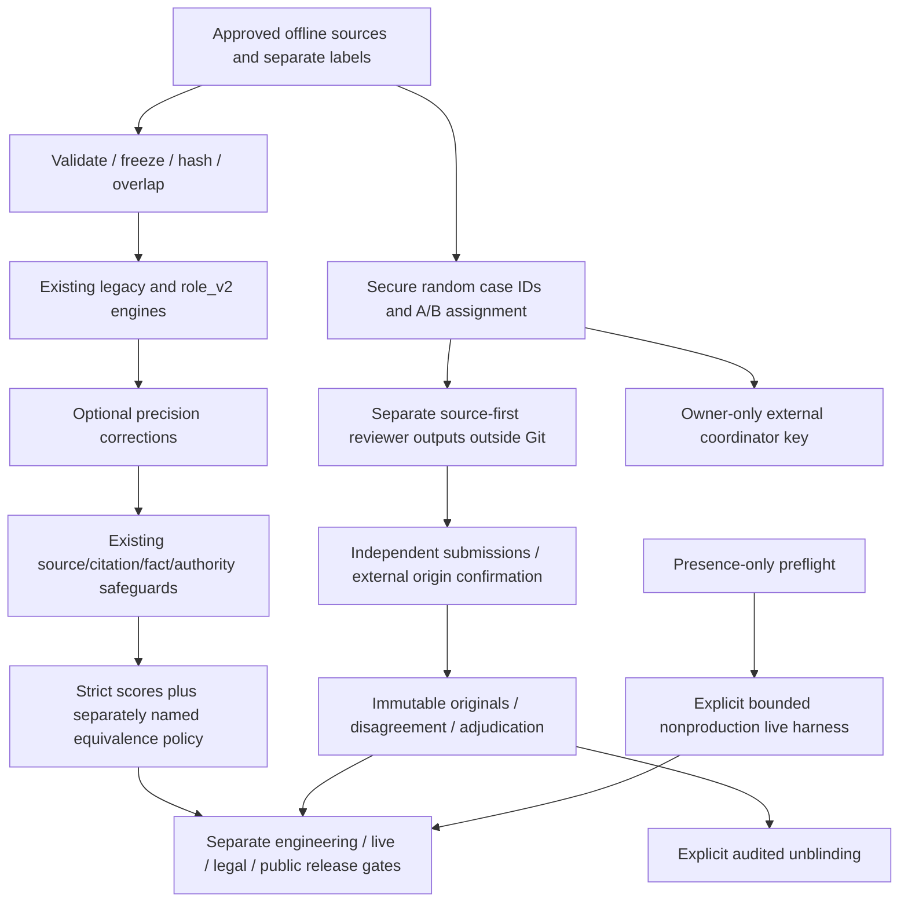

# Phase 2D architecture

Phase 2D corrects evaluation integrity and measured extraction weaknesses without
replacing skills, retrieval, clauses, citation/fact/authority or revision systems.
Existing defaults and `phase2b.v1` remain. No dependency, identity provider, public
review portal, production migration or deployment was introduced.

`validation/` contains offline tooling, not another legal reasoning framework.
`secure_review` uses existing spans and per-field agreement functions. `datasets`
validates separately supplied source/annotation provenance and freezes gold outside
Git. `benchmark` retains Phase 2C strict scoring and adds an explicitly versioned
source-definition equivalence policy. `preflight` performs no network/model loading.
`live` bounds opt-in workers; `provider_bounds` validates loaded SDK timeout fields.
`readiness` keeps four release categories independent.

`identity.py` records surface mention, defined role, canonical identity/name,
resolution basis, definition evidence and ambiguity. Canonical IDs bind exact
name to document ID/version/hash, not word similarity. Conflicting definitions
and schedule scope abstain. It is documentary identity, not registry verification.

`precision.py` handles Arabic رد by contextual object classes, or returns an
ambiguous action. It separates direct object, recipient/destination, scope qualifier
and existing exceptions/triggers/deadlines. These remain linguistic candidates.
Existing legal applicability, fulfilment, liability and human-review gates remain.

`ENABLE_CLAUSE_PRECISION_V3=false` is independent and requires role_v2 as well.
No flag enables skills, hybrid search or model calls implicitly. New identity and
boundary fields are additive only in precision mode. Default legacy and original
v2 scoring paths remain reproducible; the Phase 2C runner pins precision off.
Thirty-two subsystem/role/precision configurations were exercised through HTTP.

The optional clause-model callback now requires a verified loaded SDK timeout,
retry and output-token interface: 30-second request timeout, zero retries and
2,048 output tokens, otherwise it fails closed. Other generation/chat model paths
are unchanged; their deployment timeout policies still need validation.

No actual independent dataset, human legal review or live provider success was
available. Engineering artifacts are fictional/sanitized counts; new reviewer
packets, assignments, actual submissions and coordinator keys stay outside Git.
